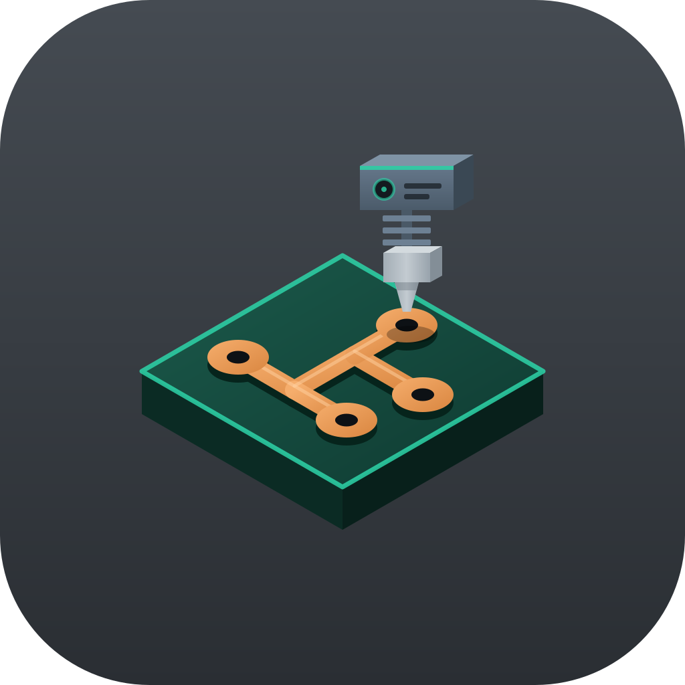

<p align="center">
  
</p>

# Tape Board

**A copper-tape circuit designer for 3D printed boards.**

Tape Board lets you design a circuit board, then 3D print it. You print the plate, press copper tape onto the raised lines, and solder component legs through the holes. No etching, no chemicals, and no PCB fab order.

Works on **Windows** and **Android**.

Created by R. Heller · [☕ Support on Buy Me a Coffee](https://buymeacoffee.com/Rheller82)

---

## Download

Open the **Releases** page and grab the file for your device:

| Device | File |
| --- | --- |
| Windows (installer) | `Tape-Board-Setup-<version>-x64.exe` |
| Windows (portable, no install) | `Tape-Board-Portable-<version>-x64.exe` |
| Android | `Tape-Board.apk` |

**Windows:** the app is not code-signed, so Windows SmartScreen may say "Windows protected your PC". Click **More info**, then **Run anyway**.

**Android:** when you open the APK, allow "install unknown apps" for your browser or file manager.

---

## How it works

1. Lay out parts and copper-tape runs on a grid-snapped board — by hand, from a schematic you draw, or automatically from a text list.
2. Check the design and preview the plate in 3D.
3. Export an **STL** file.
4. Print the plate. The STL has raised lines where the tape goes (or grooves, if you prefer), through-holes for pins, and any engraved text.
5. Press copper tape onto the lines and solder the parts in.

---

## Features

**Drawing the board**

- Place parts and draw tape runs on a grid, with undo and redo throughout.
- Confirm mode lets every change wait for approval so you can nudge it into position first — drag the whole piece, or drag a corner dot to reshape a tape run.
- Extend carries a tape run on from where it ended, keeping it as one piece with mitered corners.
- Rotate and flip parts. Tape that ends on a pad follows the part when you move it.
- Pin 1 of every multi-pin part gets a square pad so chips line up, and the square grows to match the tape running onto it.
- Grid presets from 5.08 mm down to 0.1 mm, or any custom size.
- Tape widths with 90°-only or 45° runs.

**Schematic editor**

- Draw the circuit with proper symbols, wire the pins, and let the app build the board from it.
- Give parts values (10k, 100nF, 1N4148) and pick the exact footprint for each one.
- Built-in parts list you can copy into a shopping list.
- A check before building flags name clashes, ground wired to power, unwired parts, open pins and missing values.
- **Generate PCB** builds a fresh board; **Update PCB** keeps your existing layout and only adds, removes and re-links what changed.

**Auto-generate**

- Describe the circuit as a short text list and the app places the parts and routes the tape.
- Tries up to 40 arrangements and keeps the one with the least tape on the smallest board.
- Adds jumper wires automatically where tape would have to cross.

**Checking and previewing**

- Unrouted connections show as dashed yellow lines, like a ratsnest, and disappear as you lay tape.
- **Check design** finds short circuits, copper too close together, tape that is too thin or stops short of a pad, overlapping parts, copper off the board or in a cutout, and holes cutting into copper. Tap an item to zoom to it.
- **3D preview** shows exactly what the STL will be.
- **Tape cut list** gives every run's length, width and number of bends, plus jumper wire lengths, so you can cut tape before you start.

**Finishing**

- Engraved text, plus automatic part names and LED + marks that find their own clear spot.
- Custom board outlines and cutouts, or a plain rectangle with a corner radius.
- Per-part hole and pad sizes.
- Import KiCad footprints (`.kicad_mod` and the older `.mod`).

---

## Quick start

1. Choose a part such as **Resistor** from the Parts list, then tap or click the board to place it. Parts that come in several sizes ask which one you need. Press **Confirm** (or Enter) to keep it.
2. Pick the **Tape** tool. Click where the tape starts, then where it ends. **Confirm** keeps that piece. **Extend** keeps it and carries on from where it ended. **Esc** ends the run.
3. Press **Check design** to catch mistakes.
4. Press **Export STL** and print the file.

---

## Tools

| Tool | Shortcut | What it does |
| --- | --- | --- |
| Tape | T | Draw copper tape runs |
| Part | P | Place the selected part |
| Move | V | Drag a part, a tape run or a hole |
| Select | S | Pick a part to rename it or give it its own hole and pad size |
| Rotate | — | Click a part to turn it 90° around its first pin |
| Hole | H | Add a mounting screw hole |
| Text | L | Engrave a label into the plate |
| Outline | O | Draw a custom board shape or a cutout |
| Erase | X | Remove anything on the board |

**R** rotates the part under the cursor or the one being placed. Undo and redo are **Ctrl+Z** and **Ctrl+Y**. Scroll to zoom, hold the middle mouse button to pan, and use **Fit** to reset the view. On a phone, pinch to zoom.

### Which side do parts go on?

Footprints are drawn as seen from the tape side. If you push a part's legs in from the plain side and solder on the tape side, chips, modules and connectors come out mirrored — press **⇋ Flip** (or F) for those. Flipped parts show a dashed outline and a ⇋ after their name. Two-leg parts such as resistors don't need it.

---

## Schematic editor

Click **⚡ Draw schematic** in the Auto-generate section. A full-screen drawing area opens.

| Tool | What it does |
| --- | --- |
| Place | Pick a part from the list, tap the grid to put it down. Names like R1 and D1 are assigned for you. |
| Wire | Tap one pin, then another, to join them. |
| Edit | Tap a part to select it, then set its **Value**, **Footprint**, **Rotate**, **Flip** or **Delete**. Drag to move, drag empty space to pan. |
| Delete | Tap a part (its wires go too) or a single wire. |

Every **Ground** symbol is joined to every other, and the same goes for **Power**, so you can drop them wherever you need instead of drawing long wires.

Available symbols: resistor, capacitor (plain and electrolytic), inductor, LED, diode, battery, switch, push button, buzzer, potentiometer, NPN and PNP transistors, N-MOSFET, ground and power, jumper wire, 2 to 8-pin connectors, DIP chips, ESP32, rotary encoder, TP4056 module, and a single pad or test point. Imported KiCad parts appear at the end.

Your drawing is kept on the device, so it is still there next time.

---

## Auto-generate

Describe the circuit as a text list of two kinds of line, then press **Generate layout**.

**Part lines** — a name you choose, a space, then a type:

```
J1 h2
R1 res
D1 led
```

**Connection lines** — a label, a colon, then the pins that join together:

```
VCC: J1.1 R1.1
N1:  R1.2 D1.1
GND: D1.2 J1.2
```

That's a battery, a resistor and an LED in a loop. Lines starting with `#` are notes and are ignored.

Each pin may appear on only one connection line; to join more things to the same point, add them to that line. Pins you leave out stay unconnected, and tape keeps clear of them.

### Part types

| Type | What it is | Pins |
| --- | --- | --- |
| `pad` | A single solder pad or wire point | 1 |
| `res` | Two legs 10.16 mm apart — resistor, diode | 2 |
| `led` | LED, 2.54 mm legs (pin 1 is +, pin 2 is −) | 2 |
| `leg254` `leg508` `leg762` | Two legs 2.54, 5.08 or 7.62 mm apart, such as capacitors | 2 |
| `smd1206` `smd0805` | Surface-mount resistor or capacitor pads, no holes | 2 |
| `sot23` `soic8` | Surface-mount transistor and 8-pin chip | 3 or 8 |
| `h2` `h3` `h4` `h6` `h8` | A single row of 2.54 mm pins — battery connectors, switches, buttons, sensors | 2–8 |
| `dip8` `dip14` `dip16` | DIP chips, rows 7.62 mm apart | 8, 14 or 16 |
| `jmp508` … `jmp2540` | Jumper wire, 5.08 to 25.4 mm (both ends count as joined) | 2 |
| `esp32` `enc` `tp4056` | ESP32 board, rotary encoder, TP4056 charger module | — |

Parts that don't match one of these can still be used: pick the type with the same pin count and spacing, use several `pad` parts, or import a KiCad footprint.

The **Load an example** menu has ready-made boards to read through.

---

## Print settings

| Setting | What it controls |
| --- | --- |
| Plate thickness | Thickness of the printed base |
| Traces | **Raised** lines for tape to sit on, or **Lowered** grooves |
| Trace height | How far the lines rise or sink |
| Pin hole ⌀ | Size of the through-holes for component legs |
| Larger solder pads | Optional bigger pads, with their own diameter |
| Hole compensation | Added to every hole in the STL, because printers make holes slightly small. 0.2 mm suits most printers. |
| Text size | Size of engraved labels |
| Corner radius | Rounding on a rectangular board |

**Export shape** controls the outline of the plate: the whole board, a rectangle around the design, or **Cut away unused** to save plastic. A custom outline always exports as drawn.

Very thin tape lines are hard to print. Use at least 0.8 mm for a 0.4 mm nozzle.

---

## Files

- **Export STL** — the printable plate.
- **Download SVG template (1:1)** — a full-size drawing to print on paper and check fit, or cut tape against.
- **Save design / Open design** — a `.json` file holding the board, its connections, imported footprints and your schematic drawing.

---

## Building it

1. Print the plate. A small test board first is a good idea.
2. Press copper tape along the raised lines, running it onto each pad. Trim neatly.
3. Push component legs through the holes and solder them to the tape at each pad.

---

## Changelog

### 1.0.1

**Added**

- **Schematic editor.** Draw the circuit with proper symbols, wire the pins, and build the board from it. Includes part values, a footprint picker, a parts list you can copy, undo and redo, rotate and flip, pinch-to-zoom, and a check that runs before building.
- **Update PCB** keeps your existing layout and only adds, removes and re-links what changed, instead of replacing the board.
- **Check design.** Finds short circuits, copper too close together, tape that is too thin or stops short of a pad, unrouted connections, overlapping parts, copper off the board or in a cutout, and holes cutting into copper. Tap an item to zoom to it. Comes with **Min spacing** and **Min tape width** settings.
- **3D preview** of exactly what the STL will be.
- **Tape cut list** with every run's connection, width, length and bends, plus jumper wire lengths. Copies to the clipboard.
- **Text tool (L)** engraves labels into the plate, with a **Text size** setting. **Engrave part names and LED +** adds them automatically and keeps them clear of tape and pads.
- **Outline tool (O)** draws a custom board shape or a cutout. **Corner radius** rounds a plain rectangle.
- **Flip (F)** mirrors parts whose legs go in from the plain side, so chips, modules and connectors line up. Flipped parts show a dashed outline and a ⇋ after their name.
- **Jumper wires**, both as a part you place and automatically wherever auto-generate needs tape to cross.
- **Redo**, alongside Undo.
- **Dashed connection lines** show which pins still need tape, like a ratsnest, and disappear as you lay it. Hovering a pad names its part, pin and connection, and the design summary counts what is left.
- **Rename parts** from the Select tool.
- **Hole compensation** adds a little to every hole in the STL, because printers make holes slightly small.
- **New part types:** `leg254`, `leg508` and `leg762` two-leg spacings, surface-mount pads `smd1206`, `smd0805`, `sot23` and `soic8`, and jumper wires from `jmp508` to `jmp2540`.
- Parts that come in several sizes are now listed once and ask which size you need.
- Pin 1 of every multi-pin part gets a square pad, which grows to match the tape running onto it.
- A proper app icon and logo.

**Fixed**

- Cancelling a tape run left a ghost of it on the board on phones.
- **Extend** started a new run each time, so corners met as two butted ends instead of a single mitered joint. An extended run is now one piece you can move and reshape as a whole.
- The confirm bar covered the board on phones. It is now a compact row of buttons, and the board is fitted into the space above it.
- The Android app drew underneath the status and navigation bars, hiding the clock and the bottom of the screen.
- The layout ran off the side of the screen on phones.
- Exports (STL, SVG and design files) failed silently in the Android app. They now open the share sheet.
- **Copy** on the tape cut list did nothing where the clipboard was refused.
- The Windows installer and the portable build were written to the same file name, so only one of them survived. They are now `Tape-Board-Setup-…` and `Tape-Board-Portable-…`.

### 1.0.0

First release. Board editor with tape, parts, holes and erase; grid snapping; auto-generate from a text list; KiCad footprint import; per-part hole and pad sizes; STL and SVG export; save and open designs.

---

## Credits

Tape Board was created by **R. Heller**.

If the app is useful to you, you can [buy me a coffee ☕](https://buymeacoffee.com/Rheller82).
